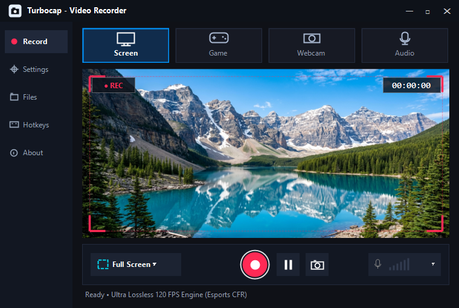
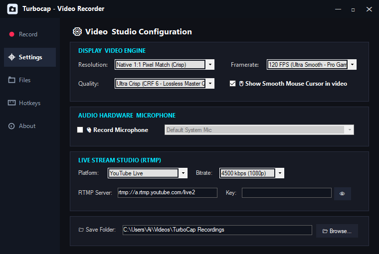
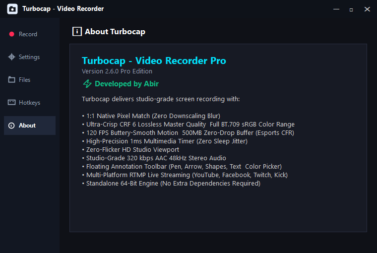

# ⚡ TurboCap — Video & Screen Recorder Pro

<p align="center">
  <br>
  <strong>High-Performance 120 FPS Screen Recording & Live Streaming Studio for Windows</strong><br>
  <em>Version 2.6.0 Pro Edition • 100% Free Forever • Zero Watermark • Zero Lag</em>
</p>

<p align="center">
  <a href="#-downloads"></a>
  <a href="#-developer--credits"></a>
  
  
  
</p>

---

## 📖 প্রজেক্ট সারসংক্ষেপ (About TurboCap)

**TurboCap** হলো উইন্ডোজের জন্য বিশেষভাবে তৈরি একটি আল্ট্রা-লাইটওয়েট, হাই-পারফরম্যান্স এবং প্রফেশনাল স্ক্রিন রেকর্ডার ও লাইভ স্ট্রিমিং সফটওয়্যার। সাধারণ অনেক সফটওয়্যারে স্ক্রিন রেকর্ড করার সময় ভিডিও আটকে যাওয়া ("বাড়ি মারা"), ফ্রেম ড্রপ হওয়া, ঝাপসা ভাব কিংবা বিরক্তিকর ওয়াটারমার্ক ও টাইম লিমিট থাকে। 

TurboCap-এ এই সমস্ত সমস্যার সমাধান হিসেবে যুক্ত করা হয়েছে:
- **120 FPS Constant Framerate (CFR)** – হাই-প্রিসিশন ১ms মাল্টিমিডিয়া টাইমার।
- **Full PC sRGB (0-255) BT.709 কালার ক্ল্যারিটি** – টেক্সট ও গ্রাফিক্সে কোনো ঝাপসা ভাব নেই।
- **লাইভ স্ক্রিন অ্যানোটেশন টুলবার** – রেকর্ডিং চলাকালীন স্ক্রিনে আঁকাআঁকি, তীরচিহ্ন, বক্স ও টেক্সট লেখার সুবিধা।
- **১০০% ফ্রি ও ওয়াটারমার্কবিহীন** – কোনো লুকানো খরচ বা সাবস্ক্রিপশন নেই।

---

## 📸 Preview Showcase

<p align="center">
  
</p>

---

## 🌟 মূল ফিচারসমূহ (Key Features)

### 1. âš¡ Rock-Solid 120 FPS & 60 FPS (Zero Lag CFR)
- উইন্ডোজের হাই-প্রিসিশন `timeBeginPeriod(1)` ১ মিলিসেকেন্ড হার্ডওয়্যার টাইমার রেজোলিউশন ব্যবহার করে ফ্রেমরেট লক রাখা হয়।
- 500MB জিরো-ড্রপ থ্রেড কিউ বাফার সংযুক্ত, যার ফলে হাই-এন্ড গেমিং বা ফাস্ট মাউস মুভমেন্টেও ভিডিও কখনো আটকে যায় না বা ফ্রেম ড্রপ হয় না।

### 2. 💎 ক্রিস্টাল ক্লিয়ার Lossless Visual Fidelity
- ডিফল্ট **CRF 6 Lossless Master Quality** এনকোডিং প্রোফাইল।
- **Full PC sRGB (0-255) BT.709** কালার ম্যাট্রিক্স সমর্থন করে। ফলে সাধারণ রেকর্ডারের মতো রঙ ফ্যাকাশে (washed-out TV range) লাগে না, বরং ডিপ ব্ল্যাক এবং নিখুঁত শার্পনেস পাওয়া যায়।

### 3. ✏️ লাইভ ফ্লোটিং ড্রয়িং টুলবার (Real-Time Annotations)
- রেকর্ডিং চলাকালীন স্ক্রিনের যেকোনো জায়গায় মাউস দিয়ে সরাসরি আঁকাআঁকি করার জন্য রয়েছে ফ্লোটিং গ্লাসবার:
  - **Pointer Mode:** সাধারণ মাউস ক্লিক মোড।
  - **Pen Tool:** ফ্রিহ্যান্ড ড্রয়িং।
  - **Arrow Tool:** নির্দিষ্ট অপশন বা বাটন দেখাতে ডিরেকশনাল তীরচিহ্ন।
  - **Rectangle Box:** যেকোনো মেনু বা উইন্ডো হাইলাইট করতে চতুর্ভুজ বক্স।
  - **Marker / Highlighter:** লেখার উপর ট্রান্সলুসেন্ট মার্কার।
  - **Text Tool:** স্ক্রিনে ক্লিক করে সরাসরি টেক্সট লেখার সুবিধা।
  - **10-Color Palette:** ১০টি আকর্ষণীয় কালার প্যালেট ও কালার পিকার।
  - **Undo & Clear:** এক ক্লিকে আগের ড্রয়িং মুছা বা ক্লিয়ার করা।

### 4. 🎙️ স্টুডিও-গ্রেড 320 kbps AAC অডিও
- হাই-কোয়ালিটি 320 kbps 48kHz স্টেরিও সাউন্ড রেকর্ড।
- মাইক্রোফোন এবং পিসির ইন্টারনাল অডিও আলাদাভাবে কিংবা একসাথে রেকর্ড করার অপশন।
- লাইভ সাউন্ড লেভেল ট্র্যাক করার জন্য রিয়েল-টাইম VU মিটার বার।

### 5. 📡 মাল্টি-প্ল্যাটফর্ম RTMP লাইভ স্ট্রিমিং
- সরাসরি TurboCap থেকেই YouTube Live, Facebook Live, Twitch কিংবা Kick-এ লাইভ স্ট্রিম করার সুবিধা।

### 6. 🛡️ 100% স্ট্যান্ডঅ্যালোন & প্রাইভেসি-ফার্স্ট
- কোনো অতিরিক্ত কোডেক বা প্লাগইন ইন্সটল করতে হয় না (FFmpeg ইঞ্জিন সরাসরি প্যাকেজড)।
- কোনো ওয়াটারমার্ক নেই, কোনো রেকর্ডিং টাইম লিমিট নেই এবং কোনো ব্যাকগ্রাউন্ড ব্লটওয়্যার বা ট্র্যাকিং নেই।

---

## 🖼️ ভিজ্যুয়াল গ্যালারি (Screenshots Gallery)

| 🖥️ Studio Recorder View | ⚙️ 120 FPS Esports Settings |
|:---:|:---:|
|  |  |
| **⚡ Verified & Authored by Abir** | **✏️ Floating Annotation Toolbar** |
|  |  |

---

## 📥 ডাউনলোড লিঙ্ক (Downloads)

* **Google Drive Direct Mirror (Standalone Setup):**
  👉 [Download TurboCap_Setup.zip on Google Drive](https://drive.google.com/file/d/1kuxVeJvwLijQ-79vS04lNrCdkZOWHamQ/view?usp=sharing)
* **GitHub Releases:**
  👉 [Download latest release from GitHub Releases](../../releases)

---

## ⌨️ ডিফল্ট শর্টকাট কি (Keyboard Hotkeys)

| হটকি (Hotkey) | অ্যাকশন (Action) |
|:---:|:---|
| **F9** | রেকর্ডিং শুরু / পজ (Pause) / পুনরায় চালু (Resume) |
| **F10** | রেকর্ডিং বন্ধ করা এবং স্বয়ংক্রিয়ভাবে ভিডিও সেভ করা |
| **Camera Icon** | এক ক্লিকে আল্ট্রা হাই-রেজোলিউশন স্ক্রিনশট নেওয়া |

---

## 🚀 সোর্স কোড থেকে বিল্ড করার নিয়ম (Build from Source)

TurboCap সম্পূর্ণ পিওর C# এবং উইন্ডোজ ফর্মসে তৈরি। এটি বিল্ড করার জন্য ভারী কোনো Visual Studio ইন্সটল করা বাধ্যতামূলক নয়; উইন্ডোজের বিল্ট-ইন `.NET Framework`-এর মাধ্যমেই এক সেকেন্ডে বিল্ড করা যায়।

### ১. ওয়ান-ক্লিক বিল্ড (Easy Method)
প্রজেক্ট ফোল্ডারে থাকা `build.bat` ফাইলে ডাবল-ক্লিক করুন, অথবা PowerShell / CMD ওপেন করে রান করুন:
```cmd
build.bat
```

### ২. ম্যানুয়াল কম্পাইলেশন (via `csc.exe`)
```cmd
C:\Windows\Microsoft.NET\Framework64\v4.0.30319\csc.exe /nologo /target:winexe /optimize+ /win32manifest:app.manifest /win32icon:app.ico /out:TurboCap.exe /r:System.dll,System.Core.dll,System.Drawing.dll,System.Windows.Forms.dll *.cs
```

### ৩. সম্পূর্ণ ইন্সটলার তৈরি (Inno Setup)
`TurboCap_Setup.exe` তৈরি করতে:
1. [Inno Setup 6](https://jrsoftware.org/isdl.php) ইন্সটল করুন।
2. `installer.iss` ফাইলে রাইট-ক্লিক করে **Compile** চাপুন।

---

## 📁 রিপোজিটরি ফাইল স্ট্রাকচার (Repository Structure)

```text
TurboCap/
├── docs/
│   └── screenshots/          # High-resolution screenshots for README
│       ├── screen_recorder.png
│       ├── screen_settings.png
│       ├── screen_about.png
│       └── screen_toolbar.png
├── AreaSelectorForm.cs       # Custom region selection with crosshair
├── AssemblyInfo.cs           # Assembly metadata & Abir credits
├── FloatingToolbarForm.cs    # Floating annotation toolbar UI
├── GlobalHotkeys.cs          # Low-level Windows keyboard hook (F9, F10)
├── IconFactory.cs            # Dynamic vector icon generation
├── MainForm.cs               # Main studio viewport, modes & settings
├── Program.cs                # Application entry point
├── RecorderEngine.cs         # FFmpeg CFR 120 FPS high-precision engine
├── RecordingBorderForm.cs    # Glowing red capture boundary overlay
├── RecordingFinishedDialog.cs# Instant preview dialog after capture
├── ScreenDrawOverlay.cs      # Transparent canvas for pen, shapes & text
├── ThemeManager.cs           # Cyber-Dark UI colors & styles
├── app.ico                   # High-res application icon
├── app.manifest              # Windows DPI awareness & admin privileges
├── build.bat                 # 1-Click C# compiler script
├── installer.iss             # Inno Setup 6 installer script
├── preview_wallpaper.jpg     # 4K mountain lake viewport wallpaper
├── LICENSE                   # MIT License
└── README.md                 # Complete documentation
```

---

## 👨‍💻 Developer & Credits

* **Developer:** Abir
* **Product:** TurboCap Pro Edition (v2.6.0)
* **License:** [MIT License](LICENSE) — সম্পূর্ণ ফ্রি এবং ওপেন সোর্স।

---

<p align="center">
  ⚡ Developed with ❤️ by <strong>Abir</strong>
</p>
